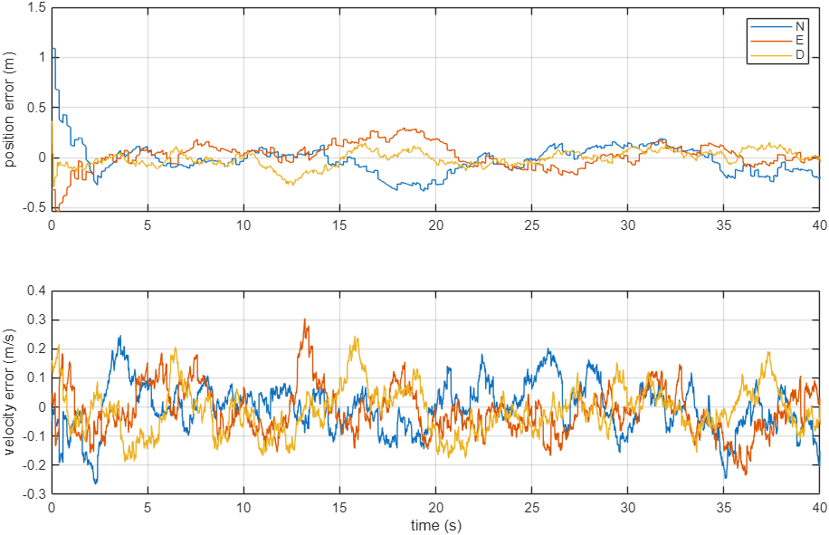
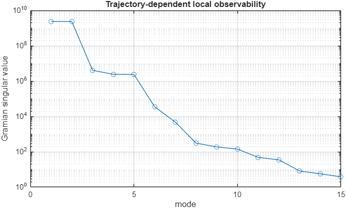

# 15-State Error-State Kalman Filter (INS / GPS / Barometer / Magnetometer)

> **Status: Work in progress.** Phase A (MATLAB model and tests) and the Phase C C core run and pass their tests.
> Phase B (real sensor data) is still at the template stage, and nothing has run on hardware yet.

This is an error-state EKF for inertial navigation, developed in three phases: MATLAB reference → calibration with real data → a C99 core for STM32F411.

## State and conventions

| Item | Definition |
|---|---|
| Nominal state (16) | `p(3), v(3), q(4), b_a(3), b_g(3)` |
| Error state (15) | `δp(3), δv(3), δθ(3), δb_a(3), δb_g(3)` |
| Navigation frame | NED |
| Quaternion | Hamilton, scalar-first, body → NED; right error `q_true = q_nom ⊗ Exp(δθ)` |
| Measurements | GPS position + velocity (with lever-arm terms), barometric altitude, magnetometer direction |

## Algorithms

- Midpoint quaternion propagation, then F/G Jacobians, then discretization with either a fast 2nd-order Φ or Van Loan (offline reference)
- Sequential scalar updates in **Joseph form** with a χ² gate (1 DoF, 99%)
- Error injection and covariance reset
- NIS/NEES statistics, Monte Carlo runs, and finite-horizon **observability Gramian** along a trajectory
- C core: static memory only (no `malloc`), Cholesky covariance health check, a health monitor (OK / DEGRADED / FAULT), and an IMU history buffer for late measurements

## Repository layout

```
matlab/            Phase A: model, simulation, filter, demos, tests/ (5 unit tests)
phase_b/           Phase B: 6-position accel calibration, Allan deviation, static IMU analysis,
                   magnetometer calibration, replay template, log schema
stm32/Inc, Src     Phase C: eskf15, eskf_math, eskf_health, app_eskf, mpu6050_adapter
stm32/integration  CubeMX USER CODE snippets
stm32/tests/native PC test for the C core
docs/              conventions, initialization, phase plan, validation checklist, references (in Vietnamese)
verify_package.sh  runs the native test and checks for dynamic allocation
```

## How to run

MATLAB (base MATLAB only, no toolboxes), from the `matlab/` folder:

```matlab
run_all_tests
run_phase_a_demo
observability_report_demo
compare_discretization
run_monte_carlo(20)
```

C core on a PC:

```bash
cd stm32/tests/native
make test
```

## Results

Re-run on 2026-09-26 (MATLAB in batch mode, GCC 15.2):

| Check | Result |
|---|---|
| `run_all_tests` | 5/5 passed (constant acceleration, quaternion norm, covariance health, mag Jacobian vs finite difference, Van Loan) |
| `run_phase_a_demo` (seed 11, 40 s) | 3D position RMSE **0.220 m**, velocity RMSE **0.143 m/s**, scalar gate pass rate 98.9%, mean NEES 12.6 |
| `run_monte_carlo(5)` | mean position RMSE 0.215 m, velocity RMSE 0.147 m/s, NEES 14.0, gate pass rate 98.9% |
| `observability_report_demo` | numerical rank **12/15** along the simulated trajectory (condition indicator 6.2e8), so some directions are weakly observable |
| Native C test | `All native ESKF tests passed.` (`-Wall -Wextra -Wpedantic -Werror`) |
| Dynamic allocation check | none found in `stm32/Inc` and `stm32/Src` |

Position and velocity error of `run_phase_a_demo` (NED, seed 11). The large error in the first second is the initial attitude/position offset converging:



Singular values of the finite-horizon observability Gramian from `observability_report_demo`. The spread over about 9 orders of magnitude shows that some error directions are only weakly observable along this trajectory:



## Fixed

- `matlab/eskf_update_gps.m`: the default-argument check was `if nargin<7` although the function has 6 inputs, so the GPS lever arm was always overwritten with zero. It is now `nargin<6`. After the fix, all 5 tests still pass, and a non-zero lever arm (0.3 m) changes the update (‖δx‖ 0 → 0.32 in a quick check). The Phase A demo uses a zero lever arm, so its numbers are unchanged.

## Known issues / not done yet

- Mean NEES (about 12–14 for 15 states) is below 15, which suggests the filter may be slightly conservative on this simulation. It has not been tuned.
- Phase B: no real IMU/GPS logs yet. `replay_log_template.m` only handles IMU and BARO events.
- Phase C: the MPU6050 adapter only converts raw data to SI units. GPS, barometer and magnetometer drivers are not included.
- No hardware-in-the-loop or flight test.

## About this code

This code was written with an AI assistant at my request. I defined the problem and the requirements.
The verification results above were re-run on my own machine.

## License

MIT. See [LICENSE](LICENSE). This is research and learning code with no warranty; it is not certified for safety-critical use.
